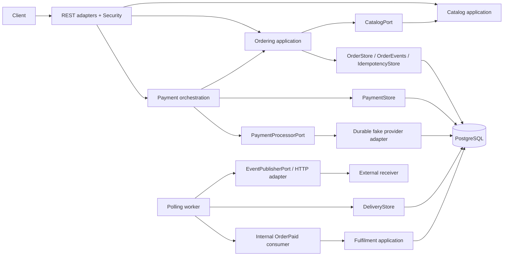
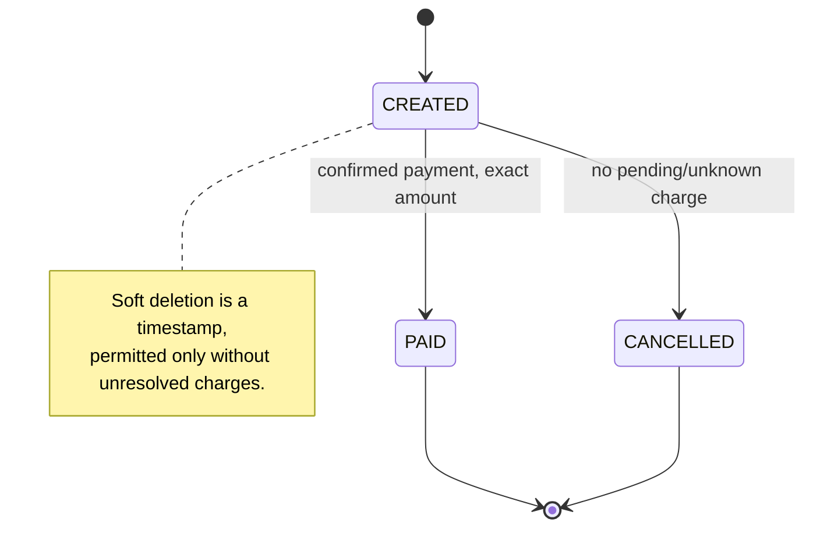
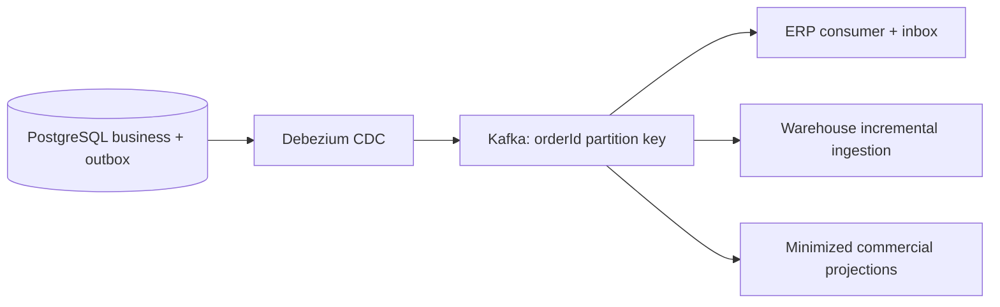

# Architecture

## Implemented modular monolith

The five capabilities deploy together and share one authoritative PostgreSQL database. Domain aggregates are framework-free. Application services use explicit outbound ports; infrastructure implements persistence, transaction, provider, HTTP, web and metrics concerns. Spring bean composition is confined to `config` and adapters. Architecture tests enforce that domain/application do not depend on frameworks or infrastructure and domain does not depend on application.



**Catalog** owns commercial product information and soft deletion, without inventory. **Ordering** owns immutable purchase snapshots, totals, commercial transitions, logical deletion and creation idempotency. **Payment** owns an independent obligation and its attempt history; its application service orchestrates Ordering through module-facing application operations. **Fulfilment** owns an independent state machine. **Integration** stores immutable snapshots and independently tracks delivery per destination.

Only Order→OrderItem and Payment→PaymentAttempt use JPA aggregate-child relationships. Cross-module associations use UUIDs and database foreign keys, not JPA relationships. Infrastructure composes summary ports for read representations without exposing entities. Order's `PaymentGuard` abstraction is implemented by Payment persistence; the Ordering core imports no Payment implementation. Shared code is limited to Money, errors, ID generation, transaction and metrics ports, and technical web concerns.

Dependencies flow **Infrastructure → Application → Domain**. Module-facing application services are explicit and statically composed; there is no service locator, generic base repository or speculative inventory port. Integration envelopes have their own immutable records rather than serializing aggregates or persistence entities.

## Aggregates and invariants

- Product: availability and deleted timestamp prevent purchase; deletion leaves existing snapshots intact.
- Order: non-empty, unique-product items, positive quantities, exact backend prices, EUR-consistent sum, immutable item snapshots. CREATED→PAID/CANCELLED only. Deleted orders are hidden from public operations. PAID cannot be deleted.
- Payment: one obligation/order; failed attempts may be followed by new attempts; PENDING/UNKNOWN blocks new charges; SUCCEEDED is terminal. Attempts retain stable operation references and outcome history.
- Fulfilment: PENDING→PROCESSING→DELIVERED→FULFILLED only. Only PENDING initialization is wired to event consumption.



Money uses BigDecimal, NUMERIC(19,2), scale 2 and UNNECESSARY rounding; inputs requiring rounding are rejected. All calculations are exact. UUIDv7 is generated by maintained java-uuid-generator 5.1.0, never by a custom algorithm. TIMESTAMPTZ and UTC represent instants. Domain defensive copies prevent callers changing item/attempt collections.

## Short transaction boundaries

`TransactionBoundary` is an application port implemented with Spring TransactionTemplate. Core services never access Spring transaction APIs. Public order reads use a short read-only REPEATABLE READ transaction on the primary, keeping order, payment and fulfilment summaries in one snapshot; a concurrent payment cannot produce a fractured pre-payment order/post-payment summary. Write orchestration uses READ COMMITTED with its explicit order locks. JPA and JdbcTemplate share Spring's database transaction, including outbox writes and operational records.

Creation: claim idempotency → resolve catalog → persist order/items → immutable OrderCreated → required deliveries → completed response → commit. Catalog lookups are local database reads, not remote I/O. Shared product-row locks keep resolved price/eligibility stable until the order transaction commits; administrative deletion waits for in-flight purchases, while concurrent purchases remain compatible.

Cancellation/deletion: lock current order row → validate domain and payment guard → cancel any eligible failed obligation → transition/delete → versioned event and deliveries → commit. Short order-row locking serializes these operations with payment acquisition. No database lock spans provider/receiver I/O.

JPA @Version protects Order, Payment, Fulfilment (also Product). Adapters explicitly compare domain versions before copying changes, then flush to capture the actual committed event version. Native operational SQL uses conditional updates and uniqueness rather than entity optimistic locking. Future fulfilment transitions must use versioned persistence; the MVP only inserts PENDING.

## Safe payment protocol

```mermaid
sequenceDiagram
  participant Client
  participant PaymentService
  participant DB as PostgreSQL
  participant Provider as PaymentProcessorPort
  Client->>PaymentService: POST pay + key
  PaymentService->>DB: short tx: lock order, claim key, validate eligibility
  PaymentService->>DB: acquire attempt, save PENDING, associate key
  DB-->>PaymentService: COMMIT (durable right to invoke)
  PaymentService->>Provider: process(stable attempt reference, stored amount)
  Provider-->>PaymentService: SUCCEEDED / FAILED / UNKNOWN
  PaymentService->>DB: short tx: lock order, resolve payment/attempt
  opt SUCCEEDED
    PaymentService->>DB: Order PAID + OrderPaid + delivery records
  end
  PaymentService->>DB: complete original response; COMMIT
  PaymentService-->>Client: current order/payment snapshot
```

The partial unique payment_attempts index permits at most one PENDING/UNKNOWN attempt per payment; payments.order_id is unique. Order locking plus payment uniqueness serializes attempts across instances. The provider executes outside a transaction. Local result persistence atomically changes Payment and Order and appends OrderPaid. A second key cannot bypass permanent successful or unresolved payment state, even after request-key expiration.

A transport exception is treated conservatively as UNKNOWN and counted, never as definitive decline. A local commit failure after provider success leaves the committed PENDING attempt to reconcile. Competing recovery/result workers re-read under the order lock; a definitively resolved attempt is not resolved a second time. There is no automatic blind retry following an optimistic conflict.

Recovery scans a bounded batch of old PENDING/UNKNOWN attempts. It performs lookup first. A missing operation is replayed only if the adapter explicitly advertises stable-key idempotent replay; otherwise the result remains UNKNOWN. Simulator process/lookup stores operations durably in a separate ledger using PostgreSQL autocommit outside business transactions. A reconstructed provider/service instance can recover the earlier persisted operation without a second charge. Explicit fake lookup configuration can resolve UNKNOWN records. Real providers need external durability, documented idempotency windows, lookup APIs and operational escalation; the fake ledger does not establish these guarantees.

Recovery keeps ambiguous obligations blocked indefinitely rather than timing them into FAILED. Bounded poll size/age limits work per iteration, not the total reconciliation lifetime. Database outages leave claims recoverable. Operators must monitor unresolved age; provider-specific escalation, retention and recovery alerting are production work.

## Persistent request idempotency

Uniqueness is `(customer_scope, operation, idempotency_key)`. Payment operation includes orderId. `INSERT ... ON CONFLICT DO NOTHING` atomically acquires ownership; concurrent creation either waits for the first commit and replays, or sees a processing conflict. Payment acquisition commits PROCESSING before provider I/O; repeated in-flight requests return 409 and Retry-After.

SHA-256 hashes a deterministic, length-prefixed representation: exact customerId plus UUID-sorted product/quantity lines, excluding the key. It never hashes raw JSON formatting. Duplicate products are rejected. A changed canonical payload with an existing key returns 409.

Completed response JSON stores the original representation, not reconstructed current mutable business state. Creation replay stays CREATED even after payment; an UNKNOWN payment replay stays UNKNOWN after reconciliation. GET returns current state. Default retention is 24h; expired completed records can be replaced on reuse, but PROCESSING never expires away. Permanent business constraints remain. Production must add bounded cleanup and monitor orphaned processing records.

## Transactional outbox and independent destinations

```mermaid
sequenceDiagram
  participant UseCase
  participant DB as PostgreSQL
  participant Worker
  participant HTTP as External receiver
  participant F as Fulfilment consumer
  UseCase->>DB: business change + immutable event + delivery rows
  DB-->>UseCase: COMMIT
  Worker->>DB: short claim tx, FOR UPDATE SKIP LOCKED
  DB-->>Worker: event snapshots + lease + claim_token; COMMIT
  loop Each claimed destination (sequential in this worker)
  alt HTTP destination
    Worker->>HTTP: POST original envelope + eventId idempotency header
    HTTP-->>Worker: 2xx acknowledgement
    Worker->>DB: conditional DELIVERED by current token/live lease
  else FULFILMENT destination
    Worker->>DB: short tx, lock live delivery
    Worker->>F: initialize PENDING if absent
    F->>DB: INSERT fulfilment ON CONFLICT(order_id) DO NOTHING
    Worker->>DB: acknowledge same token in same transaction
  end
  end
```

The diagram shows independent logical destinations: this MVP worker processes a bounded batch sequentially. HTTP failure does not gate internal delivery; each has its own row/status/retry budget. The lease configuration must exceed worst-case batch HTTP timeout to avoid handing later entries an already expired lease. Multiple instances safely claim disjoint live rows.

Envelope: eventId, eventType, eventVersion, aggregateId, aggregateVersion, occurredAt, data. Events are OrderCreated, OrderPaid, OrderCancelled and OrderDeleted, schema v1. Data carries customer, status, exact total/currency, item name/price snapshots, timestamps, relevant payment summary and correlation identifier. No provider secrets appear. Stored JSONB is the original transition snapshot, never reconstructed later.

Claim is a short CTE transaction using SKIP LOCKED. Pending due rows and expired processing rows are atomically moved to PROCESSING with a lease/token. HTTP runs after commit; only 2xx acknowledges. Completion/failure is conditional on eventId, destination, status, current token and live lease. An expired worker cannot overwrite a new owner, even after receiving successful HTTP acknowledgement. Duplicate HTTP delivery remains possible, including receiver commit before sender crash.

Failed deliveries retain the event and class-level error information, increment retry_count, and use bounded exponential backoff. The retry limit moves them to visible EXHAUSTED state. The documented SQL recovery selects a specific exhausted event. No event is silently dropped. An outage does not roll back committed order creation. Existing external deliveries remain pending/recoverable when the receiver URL is changed or disabled; they are not deleted.

Fulfilment initialization and delivery acknowledgement share one transaction. Unique order_id suppresses duplicate OrderPaid initializations. If acknowledgement fails, initialization rolls back. External receiver availability is irrelevant to this guarantee. **At-least-once**, not exactly-once end-to-end, is the stated delivery model.

Polling multiple workers does not guarantee per-order event order. Consumers that require it should durably buffer events and track aggregateVersion, applying expected predecessors in sequence; business versions may contain gaps (e.g. attempt acquisition has a version increment without an event), so they must not assume every integer produces an event. Alternatively use a dedicated ordered relay per aggregate, or later Kafka partitioning by orderId. Consumers of event-carried snapshots may ignore stale versions only if their projection is a last-state view; append-only financial/audit consumers must not silently discard older distinct facts.

## Observability and operations

Actuator exposes liveness, readiness (including database), and ADMIN-protected metrics. Structured logstash JSON includes correlation IDs on request errors; events carry correlation across delivery. No complete bodies or credentials are logged. HTTP request and database pool metrics come from Spring/Micrometer. Bounded business counters and delivery backlog/lag/exhausted gauges have no customer/order/event metric labels. Business counters are registered after transaction commit; fulfilment counts actual inserts.

Startup requires PostgreSQL, migrations and credential configuration. Database unavailability fails startup or returns safe request errors; workers log the failure and retain persisted work. Graceful HTTP shutdown and scheduling wait permit completion where possible; ContextClosedEvent prevents acquiring new batches. Leases recover hard shutdowns. Pool, timeouts, batch size, lease and retry limits are configuration, not per-request user controls.

## Workload planning: 500,000 orders/day

These are **planning scenarios**, not benchmark results:

| Scenario | Order creation operations/second |
|---|---:|
| Average | 500,000 / 86,400 = 5.79 |
| 10× | 57.9 |
| 50× | 289.4 |
| 100× | 578.7 |

Order creation throughput differs from retrieval and payment throughput. For illustration, one payment and two GETs/order means ~23.15 API requests/second average, before retries, monitoring or admin calls. A 100× aligned burst could mean ~2,315 requests/second, not merely 579.

A typical paid order adds one order, N items, one payment, one attempt, two integration events, two HTTP deliveries and one internal delivery, plus two request keys and simulator records. Business database transactions include creation, payment claim, payment result, internal consumption and two HTTP acknowledgements (~6/order, plus amortized batched claims), before GET transactions, retries or simulation I/O. This implies roughly 35 write transactions/second average plus reads and additional queries; it is an explanatory amplification estimate, not a measured capacity prediction. External delivery rate is ~11.6 events/second average for one receiver; internal initialization is ~5.8/second. Adding three independent external destinations would multiply delivery rows/traffic, not order creation frequency.

### Application scaling

Stateless Spring MVC instances behind a load balancer can share PostgreSQL. No JVM lock is a correctness boundary. Scale API replicas against CPU/latency/pool waits and workers against delivery lag. A sequential batch is intentionally simple; many slow receivers can limit a worker's throughput. Bounded parallel publisher execution with independently sized leases and concurrency can be introduced after measuring lag.

A per-instance Hikari pool of 16 is a starting point, not a recommendation for unlimited replicas: 8 instances imply 128 connections before migrations/operations. Reserve database headroom and cap total connections against PostgreSQL limits. Add request timeouts, ingress concurrency/rate limits and backpressure before scaling replicas blindly. Unknown provider results must preserve durable safety despite client timeout. Graceful rolling restarts preserve leases/claims, not live processes.

The modular monolith minimizes deploy/transaction complexity at this workload's modest average. Independent services become justified by independent ownership, sustained resource isolation needs, separate release lifecycles or measured scaling bottlenecks. Splitting services introduces asynchronous coordination and operational costs; microservices do not inherently make writes faster.

### Database growth and retention

At 500,000/day: ~182.5 million order rows/year; at three items/order ~547.5 million item rows/year; two events/order ~365 million event rows/year; three delivery rows/paid order ~547.5 million delivery rows/year. Payments/attempts add ~182.5 million each/year before retries. JSON payloads and indexes may dominate bytes. Finite key retention alone does not remove expired rows in this MVP, so unattended growth is a production gap.

Indexes follow access patterns: UUID PK lookup, order_items unique(order_id,product_id) covers item lookup, unique order_id for payments/fulfilments, payment_id attempt lookup, partial active uniqueness/recovery, partial pending and lease delivery indexes, idempotency uniqueness/expiry. There is no redundant UUID PK index or index-every-column strategy. Use EXPLAIN (ANALYZE, BUFFERS), pg_stat_statements, autovacuum tuning and measured pool waits before changing indexes.

Define operational retention/archival separately from legal order/payment retention. Archive delivered outbox records/events only after required consumer reconciliation/replay windows; never purge unresolved attempts, pending/exhausted delivery evidence or needed original responses blindly. Later time-range partitioning may simplify large append-heavy archival and vacuum; coordinate FK/unique constraints and UUID lookups before migration. No premature partitioning/sharding is implemented.

Read replicas may serve stale-tolerant catalog/reporting reads; authoritative reads should serve read-after-write order/payment status. Analytics belong outside OLTP. Production needs encrypted backups, continuous WAL/PITR, tested restores, explicit RPO/RTO, HA/failover and disaster-recovery drills; none are proven by a functional MVP.

## Event-driven evolution and downstream systems



Polling can be replaced by CDC when measured throughput/latency, operational teams and consumer fanout justify Kafka's costs. Preserve stable event IDs/envelopes; select orderId as partition key for per-order log ordering. A partition's ordering is not global ordering or exactly-once business effects. Consumers still need durable idempotency and their own transactions.

Additive v1 schema changes require tolerant readers; breaking semantics require a new eventVersion and compatibility plan. Track consumer lag, exhausted/dead-letter records and per-destination reconciliation. Replay uses retained immutable events; historical backfills need snapshots and high-water marks without double-applying financial facts. CDC initial snapshots and cutover require reconciliation against outbox state, not silently publishing every historical row as a new fact.

- **ERP:** financial/operational facts, durable inbox/eventId deduplication, independent retries and order/payment reconciliation. Never block the API on ERP uptime.
- **Data Warehouse:** initial consistent snapshot plus incremental ingestion, watermarks, historical backfills and schema evolution. Analytics queries run away from OLTP. Reconcile totals/counts and late corrections.
- **Martech:** commercial events projected to consumer-specific minimized data, lawful access, deletion/retention requirements and privacy controls. Do not export complete operational payloads by default simply because the outbox has them.

## Future Inventory module (not implemented)

Create order → reserve stock → process payment → confirm reservation after success → release after definitive failure or eligible cancellation. Initially use short pessimistic row locking for scarce stock invariants; conditional atomic updates may be a measured future optimization. No inventory abstraction exists in the MVP.

Reservation expiry requires explicit handling: an UNKNOWN payment cannot simply release inventory while a charge may have succeeded. Reconcile first or apply a defined operational hold/escalation policy. Coordinate timeout/cancellation/reservation/payment states and introduce integration events only when the module exists. A service split would require compensations; no distributed transactions are proposed.
